# Modul 3 - Pemulihan Jaringan dan Layanan Jujutsu High

## Kelompok K-51

| Nama | NRP |
|---|---|
| Arrumanta Ekna Luhkinasih | 5027251044 |
| Muhammad Hugo Rayandra E | 5027251076 |

**Jaringan internal:** `10.89.0.0/16`, dibagi menjadi empat subnet `/24`  
**Lingkungan:** GNS3, Docker, Debian/Alpine, ISC DHCP, BIND9, MariaDB, Nginx, PHP-FPM, dan ApacheBench

## Daftar Isi

- [Topologi dan alamat IP](#topologi-dan-alamat-ip)
- [Persiapan umum](#persiapan-umum)
- [Soal 1 — Routing, IP, forwarding, dan NAT](#soal-1--routing-ip-forwarding-dan-nat)
- [Soal 2 — DHCP Server Tengen](#soal-2--dhcp-server-tengen)
- [Soal 3 — DHCP Relay Jichi](#soal-3--dhcp-relay-jichi)
- [Soal 4 — DHCP pool berdasarkan MAC](#soal-4--dhcp-pool-berdasarkan-mac)
- [Soal 5 — Short lease dan long lease](#soal-5--short-lease-dan-long-lease)
- [Soal 6 — DHCP fixed address Kugisaki](#soal-6--dhcp-fixed-address-kugisaki)
- [Soal 7 — Validasi konfigurasi seluruh klien](#soal-7--validasi-konfigurasi-seluruh-klien)
- [Soal 8 — Packet capture DHCP](#soal-8--packet-capture-dhcp)
- [Soal 9 — Simulasi gangguan DHCP Relay](#soal-9--simulasi-gangguan-dhcp-relay)
- [Soal 10 — Persistensi setelah restart](#soal-10--persistensi-setelah-restart)
- [Soal 11 — DNS Master dan Slave](#soal-11--dns-master-dan-slave)
- [Soal 12 — A, CNAME, PTR, dan DNS Forwarder](#soal-12--a-cname-ptr-dan-dns-forwarder)
- [Soal 13 — MariaDB Master-Slave](#soal-13--mariadb-master-slave)
- [Soal 14 — Frontend dan API worker](#soal-14--frontend-dan-api-worker)
- [Soal 15 — Internal Load Balancer Geto](#soal-15--internal-load-balancer-geto)
- [Soal 16 — Public reverse proxy Gojo](#soal-16--public-reverse-proxy-gojo)
- [Soal 17 — Penerusan IP klien](#soal-17--penerusan-ip-klien)
- [Soal 18 — API fallback ke Kirara](#soal-18--api-fallback-ke-kirara)
- [Soal 19 — Proxy cache dan rate limiting](#soal-19--proxy-cache-dan-rate-limiting)
- [Soal 20 — Benchmark dengan ApacheBench](#soal-20--benchmark-dengan-apachebench)

## Topologi dan alamat IP

### Gateway dan subnet

| Network | Subnet | Gateway Jichi | Kegunaan |
|---|---|---|---|
| Network 1 | `10.89.1.0/24` | `10.89.1.1` (`eth1`) | DMZ: DNS dan public reverse proxy |
| Network 2 | `10.89.2.0/24` | `10.89.2.1` (`eth2`) | Klien Divisi A |
| Network 3 | `10.89.3.0/24` | `10.89.3.1` (`eth3`) | Klien Divisi B |
| Network 4 | `10.89.4.0/24` | `10.89.4.1` (`eth4`) | Data Center |
| WAN | Jaringan NAT GNS3 | NAT gateway biasanya `192.168.122.1` | Koneksi eksternal |

### Pemetaan node

| Node | Peran | IP yang digunakan dalam konfigurasi/draft |
|---|---|---|
| `jichi` | Router utama dan DHCP Relay | `eth0` WAN dari NAT; `eth1`–`eth4` masing-masing `10.89.1.1`–`10.89.4.1` |
| `tengen` | DHCP Server | `10.89.4.10` |
| `utahime` | DNS Master | `10.89.1.2` |
| `shoko` | DNS Slave | `10.89.1.3` |
| `gojo` | Public reverse proxy | `10.89.1.4` |
| `geto` | Internal API load balancer | `10.89.4.11` |
| `maki` | Frontend worker | `10.89.4.12` |
| `panda` | Frontend worker | `10.89.4.13` |
| `nanami` | API worker utama | `10.89.4.14` |
| `todo` | API worker utama | `10.89.4.15` |
| `kirara` | API worker cadangan | `10.89.4.16` |
| `yaga` | MariaDB Master | `10.89.4.22` |
| `inumaki` | MariaDB Slave | Periksa IP aktual pada topologi/configurasi GNS3; IP tidak dipastikan dalam draft yang tersedia |
| `itadori`, `fushiguro` | Klien DHCP Pool 1 | Network 2 |
| `zenin`, `okkotsu` | Klien DHCP Pool 2 | Network 2 |
| `ino`, `kusakabe` | Klien short lease | Network 3 |
| `miwa` | Klien long lease | Network 3 |
| `kugisaki` | Klien fixed address | Network 3 |

**Catatan:** Pastikan tidak ada dua node memakai IP yang sama. Pada Network 1, Utahime adalah `.1.2`, Shoko `.1.3`, dan Gojo `.1.4`. Domain dan nama database menggunakan `K-51` sesuai kelompok; jika prefix resmi berbeda, sesuaikan sebelum menjalankan script.

### Bukti 1.1 — TOPOLOGI


## Persiapan umum

- Gunakan image Docker yang ditentukan praktikum: `ardhptr21/debinet:latest` untuk server/infrastruktur dan `ardhptr21/alpinet:latest` untuk klien.
- Simpan script konfigurasi di direktori `/root` pada node terkait.
- Untuk persiapan awal instalasi paket, DNS sementara yang digunakan dalam draft adalah `192.168.122.1`.
- Pastikan node Jichi aktif dan jalur antar-subnet tersedia sebelum menguji layanan yang berada di jaringan berbeda.
- Periksa IP dan route menggunakan `ip -br -4 addr` dan `ip route`.
- Jangan menjalankan ulang script awal seperti `no2.sh` setelah konfigurasi DHCP nomor 4–10 selesai, karena script awal dapat menimpa konfigurasi pool/class yang lebih lengkap.
- Di lingkungan ini, layanan BIND9 dipanggil sebagai `named` (`service named`), karena `/etc/init.d/named` tersedia sementara `/etc/init.d/bind9` tidak tersedia.

## Soal 1 — Routing, IP, forwarding, dan NAT

### Tujuan

Memulihkan konektivitas empat subnet melalui router Jichi, mengaktifkan IPv4 forwarding dan source NAT, serta menetapkan IP statis host infrastruktur.

### Konfigurasi utama

| Interface Jichi | Konfigurasi |
|---|---|
| `eth0` | WAN dari NAT GNS3 |
| `eth1` | `10.89.1.1/24` |
| `eth2` | `10.89.2.1/24` |
| `eth3` | `10.89.3.1/24` |
| `eth4` | `10.89.4.1/24` |

Script fondasi dapat disimpan sebagai `/root/setup_jichi.sh`. Rangkaian tugasnya adalah menaikkan interface, meminta alamat WAN melalui DHCP, mengaktifkan `net.ipv4.ip_forward=1`, dan menambahkan NAT `MASQUERADE` melalui `eth0`.

### Verifikasi

```bash
ip -br addr
ip route
cat /proc/sys/net/ipv4/ip_forward
iptables -t nat -L POSTROUTING -n -v
```

Kriteria: gateway untuk semua subnet muncul, default route mengarah ke gateway NAT, forwarding bernilai `1`, dan aturan `MASQUERADE` pada jalur WAN tersedia. Uji konektivitas host ke gateway masing-masing dan uji akses eksternal dari host yang relevan.

## Soal 2 — DHCP Server Tengen
 
### Tujuan
 
Memasang `isc-dhcp-server` pada Tengen dengan IP `10.89.4.10`, mendeklarasikan Network 4 tanpa pool dinamis, dan menyediakan scope awal untuk Network 2 serta Network 3.
 
### Konfigurasi awal
 
Simpan script sebagai `/root/no2.sh` di Tengen. Script awal memasang `isc-dhcp-server`, menetapkan `eth0` sebagai interface layanan pada `/etc/default/isc-dhcp-server`, lalu membuat deklarasi subnet:
 
- Network 4: `10.89.4.0/24`, tanpa pool dinamis.
- Network 2: scope awal `10.89.2.100–10.89.2.200`, gateway `10.89.2.1`.
- Network 3: scope awal `10.89.3.100–10.89.3.200`, gateway `10.89.3.1`.
Deklarasi Network 4 tetap diperlukan walaupun tidak memiliki `range`. Tengen terhubung ke Network 4 melalui `eth0` (`10.89.4.10`), dan `dhcpd` menolak berjalan dengan error `No subnet declaration for eth0` apabila subnet interface yang didengarkan tidak dideklarasikan.
 
Isi `/etc/default/isc-dhcp-server`:
 
```conf
INTERFACESv4="eth0"
INTERFACESv6=""
```
 
Scope awal dan opsi DNS sementara (`192.168.122.1`) pada Soal 2 kemudian diperinci oleh Soal 4–6. Setelah konfigurasi pool lanjutan dibuat, jangan jalankan ulang `no2.sh` karena dapat menimpa file `/etc/dhcp/dhcpd.conf`.
 
### Verifikasi
 
```bash
cat /etc/default/isc-dhcp-server
dhcpd -t -cf /etc/dhcp/dhcpd.conf
service isc-dhcp-server status
pgrep -af dhcpd
ip -br -4 addr
ip route
```
 
Kriteria: konfigurasi valid, layanan aktif, dan tidak ada error `No subnet declaration`.
 
Jika restart gagal dengan pesan `Syntax error: Unterminated quoted string` dari `/etc/default/isc-dhcp-server`, tulis ulang file tersebut sesuai isi di atas, lalu restart layanan.
 
---
 
## Soal 3 — DHCP Relay Jichi
 
### Tujuan
 
Meneruskan permintaan DHCP dari Network 2 dan Network 3 ke DHCP Server Tengen (`10.89.4.10`).
 
### Konfigurasi
 
Simpan script di `/root/no3.sh` pada Jichi. Script memasang `isc-dhcp-relay`, mengatur server tujuan `10.89.4.10`, dan mengaktifkan IPv4 forwarding. Konfigurasi `/etc/default/isc-dhcp-relay`:
 
```conf
SERVERS="10.89.4.10"
INTERFACES="eth2 eth3 eth4"
OPTIONS=""
```
 
| Interface | Fungsi pada relay |
|---|---|
| `eth2` | Menerima DHCPDISCOVER/DHCPREQUEST dari klien Network 2 |
| `eth3` | Menerima DHCPDISCOVER/DHCPREQUEST dari klien Network 3 |
| `eth4` | Jalur menuju Tengen; menerima balasan DHCPOFFER/DHCPACK dari server |
 
`eth4` disertakan karena relay harus mendengarkan interface yang menghadap DHCP Server. Tanpa `eth4`, request dari klien dapat diteruskan ke Tengen, tetapi balasan server tidak diproses oleh relay sehingga klien tidak memperoleh lease.
 
IPv4 forwarding dipersistenkan melalui `/etc/sysctl.conf`:
 
```conf
net.ipv4.ip_forward=1
```
 
### Verifikasi
 
```bash
cat /etc/default/isc-dhcp-relay
cat /proc/sys/net/ipv4/ip_forward
pgrep -af dhcrelay
```
 
`pgrep` digunakan sebagai bukti utama karena container tidak memakai systemd. Jika `dhcrelay` dijalankan langsung (bukan melalui `service isc-dhcp-relay start`), file PID tidak dibuat sehingga `service isc-dhcp-relay status` tidak menampilkan output walaupun proses berjalan. Output yang diharapkan:
 
```text
/usr/sbin/dhcrelay -q -i eth2 -i eth3 -i eth4 10.89.4.10
```
 
Pada klien Network 2 dan Network 3, pastikan `eth0` memakai DHCP, kemudian minta lease:
 
```bash
udhcpc -i eth0 -n -q
ip -4 addr show dev eth0
ip route
```
 
Kriteria: klien dari kedua subnet memperoleh lease dari Tengen melalui relay, dengan default route ke gateway subnet masing-masing (`10.89.2.1` atau `10.89.3.1`).


## Soal 4 — DHCP pool berdasarkan MAC

### Tujuan dan pembagian pool

Tengen membedakan klien Network 2 melalui DHCP `class`/`subclass` berdasarkan MAC Address.

| Class | Klien | MAC Address | Pool |
|---|---|---|---|
| `pool1` | Itadori | `02:42:f3:c2:a9:00` | `10.89.2.10–10.89.2.35` |
| `pool1` | Fushiguro | `02:42:fc:e1:eb:00` | `10.89.2.10–10.89.2.35` |
| `pool2` | Zenin | `02:42:31:3c:b7:00` | `10.89.2.70–10.89.2.95` |
| `pool2` | Okkotsu | `02:42:a4:79:21:00` | `10.89.2.70–10.89.2.95` |

Rentang `10.89.2.36–10.89.2.69` tidak boleh diberikan kepada klien. Gunakan `allow members of` untuk memastikan masing-masing class hanya memperoleh alamat dari pool yang ditentukan.

### Verifikasi

Pada Tengen:

```bash
dhcpd -t -cf /etc/dhcp/dhcpd.conf
service isc-dhcp-server status
grep -nE 'class |subclass |range |subnet ' /etc/dhcp/dhcpd.conf
grep -E 'lease |hardware ethernet|client-hostname' /var/lib/dhcp/dhcpd.leases
```

Di setiap klien:

```bash
udhcpc -i eth0 -n -q
ip -4 addr show dev eth0
ip route
```

Hasil pengujian yang tercatat: Itadori `10.89.2.10`, Fushiguro `10.89.2.11`, Zenin `10.89.2.70`, dan Okkotsu `10.89.2.71`.

### Bukti 4 — Hasil Lease Klien
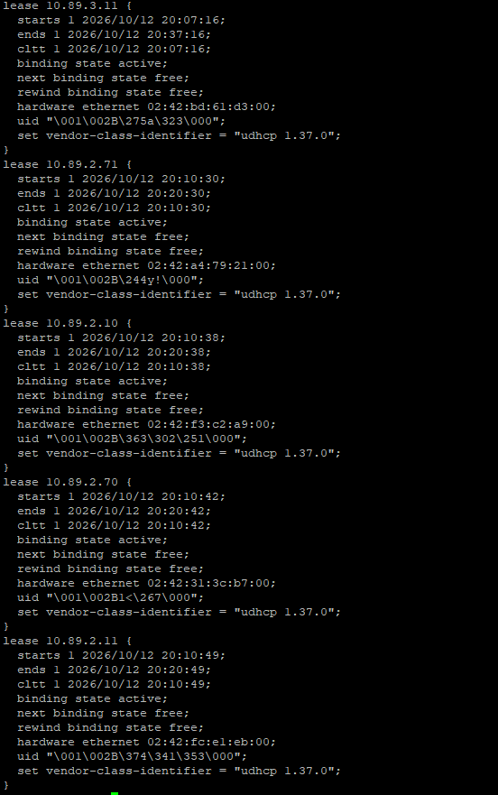

---

## Soal 5 — Short lease dan long lease

### Tujuan

Menerapkan masa lease yang berbeda pada Network 3 menggunakan class DHCP berdasarkan MAC Address.

| Class | Klien | MAC Address | Pool | Lease |
|---|---|---|---|---:|
| `short_lease` | Ino | `02:42:bd:61:d3:00` | `10.89.3.10–10.89.3.89` | 1800 detik |
| `short_lease` | Kusakabe | `02:42:45:2a:7e:00` | `10.89.3.10–10.89.3.89` | 1800 detik |
| `long_lease` | Miwa | `02:42:07:5f:61:00` | `10.89.3.100–10.89.3.199` | 43200 detik |

Konfigurasi DHCP Network 3 juga memberikan:

- Subnet mask: `255.255.255.0`.
- Gateway: `10.89.3.1`.
- Broadcast: `10.89.3.255`.
- DNS: `10.89.1.2` dan `10.89.1.3`.
- Domain search: `K-51.com`.

Script `/root/no5.sh` pada Tengen mempertahankan Pool 1 dan Pool 2 dari Soal 4 lalu menambahkan class short/long lease. Pastikan Miwa dan klien terkait memakai DHCP, bukan IP statis.

### Verifikasi

```bash
dhcpd -t -cf /etc/dhcp/dhcpd.conf
service isc-dhcp-server status
grep -nE 'class |subclass |range |default-lease-time|max-lease-time|domain-search' /etc/dhcp/dhcpd.conf
```

Uji klien dengan meminta lease baru. Untuk membuktikan durasi lease, periksa DHCP Offer/ACK pada packet capture. Hasil yang pernah terlihat pada Kusakabe adalah lease `1800` detik, gateway `10.89.3.1`, DNS `10.89.1.2` dan `10.89.1.3`, serta domain search `K-51.com`.

### Bukti 5 — Hasil Lease Client
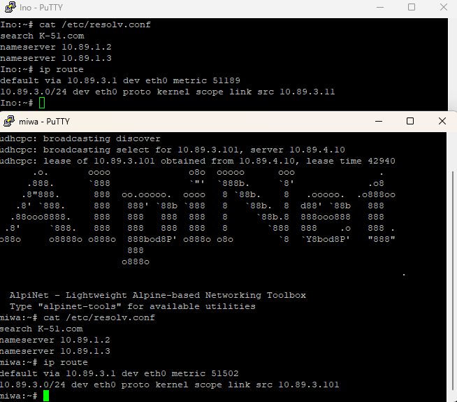
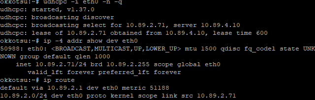

---

## Soal 6 — DHCP fixed address Kugisaki

### Tujuan

Memberikan alamat tetap `10.89.3.99` kepada Kugisaki berdasarkan MAC Address `02:42:42:0e:67:00`.

Alamat `.3.99` berada di luar pool short lease `.3.10–.3.89` dan long lease `.3.100–.3.199`.

### Verifikasi

Pada Tengen:

```bash
dhcpd -t -cf /etc/dhcp/dhcpd.conf
grep -A3 -B1 'host kugisaki' /etc/dhcp/dhcpd.conf
```

Deklarasi yang diharapkan:

```conf
host kugisaki {
    hardware ethernet 02:42:42:0e:67:00;
    fixed-address 10.89.3.99;
}
```

Di Kugisaki, pastikan interface menggunakan DHCP, kemudian minta lease baru:

```bash
pkill udhcpc 2>/dev/null || true
ip addr flush dev eth0
udhcpc -i eth0 -n -q -f
ip -4 addr show dev eth0
ip route
```

Hasil pengujian: Kugisaki memperoleh `10.89.3.99` melalui DHCP, bukan karena alamat statis yang dikonfigurasi manual.

### Bukti 6.1 — Konfigurasi Reservasi


### Bukti 6.2 — IP Kugisaki
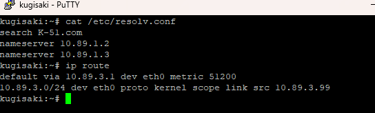

---

## Soal 7 — Validasi konfigurasi seluruh klien

### Tujuan

Memastikan klien Network 2 dan Network 3 menerima IP, subnet mask, gateway, broadcast, DNS, domain search, dan lease yang sesuai.

### Pemeriksaan di klien

Jalankan pada setiap klien yang relevan:

```bash
hostname
ip -4 addr show dev eth0
ip route
cat /etc/resolv.conf
cat /etc/network/interfaces
```

### Pemeriksaan di Tengen

```bash
bash /root/no7.sh
cat /var/lib/dhcp/dhcpd.leases
grep -inB4 -A15 '02:42:f3:c2:a9:00' /var/lib/dhcp/dhcpd.leases
```

Ulangi pencarian lease untuk MAC Address klien lain yang perlu diverifikasi. Bedakan catatan lease historis dengan lease aktif saat pemeriksaan.

Hasil alamat yang tercatat pada pengujian:

| Klien | IP yang diharapkan/tercatat | Kebijakan |
|---|---|---|
| Itadori | `10.89.2.10` | Pool 1 |
| Fushiguro | `10.89.2.11` | Pool 1 |
| Zenin | `10.89.2.70` | Pool 2 |
| Okkotsu | `10.89.2.71` | Pool 2 |
| Ino | `.3.10–.3.89` (lease mencatat `.3.11`) | Short lease |
| Kusakabe | `10.89.3.10` | Short lease |
| Miwa | `.3.100–.3.199` (lease mencatat `.3.101`) | Long lease |
| Kugisaki | `10.89.3.99` | Fixed address |

Periksa IP aktual pada terminal Ino dan Miwa, lalu bukti masa lease Miwa selama `43200` detik sebelum menyatakan seluruh aspek validasi selesai.

### Bukti 7.1 — IP dan Routing Klien
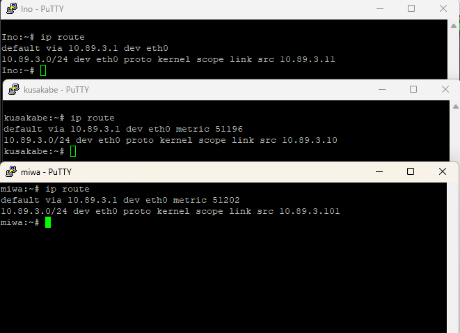

### Bukti 7.2 — DHCP Lease Tengen
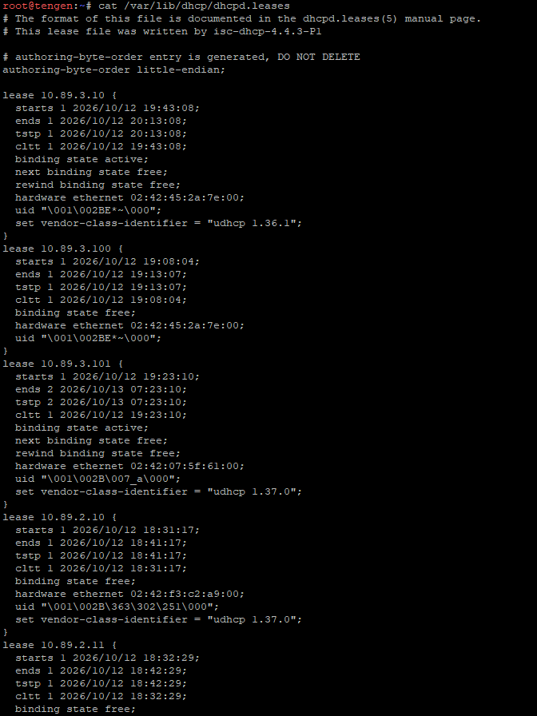

---

## Soal 8 — Packet capture DHCP

### Tujuan

Membuktikan urutan DHCP DORA dan memeriksa DHCP Server, alamat yang ditawarkan, lease time, serta field `giaddr`.

### Prosedur

1. Mulai capture di Wireshark pada jalur yang dilewati request DHCP; sesuai soal, `tcpdump` di Tengen juga dapat digunakan bila diperlukan.
2. Gunakan filter Wireshark `dhcp` atau `bootp`, sesuai versi Wireshark.
3. Paksa satu klien Network 2 atau Network 3 meminta lease baru.
4. Identifikasi urutan `DHCPDISCOVER → DHCPOFFER → DHCPREQUEST → DHCPACK`.
5. Catat Server Identifier, Your-IP/yiaddr, lease time, subnet mask, router, DNS, domain search, dan `giaddr`.

Perintah capture alternatif pada Tengen:

```bash
tcpdump -ni eth0 -vvv 'udp port 67 or udp port 68'
```

Dalam pengujian Itadori, server yang terlihat adalah `10.89.4.10`, alamat yang ditawarkan `10.89.2.10`, dan lease time `600` detik. `giaddr` harus sesuai dengan interface Jichi yang menerima request klien; untuk Network 2 nilainya diharapkan `10.89.2.1`.

### Bukti 8 — Detail Paket DHCP
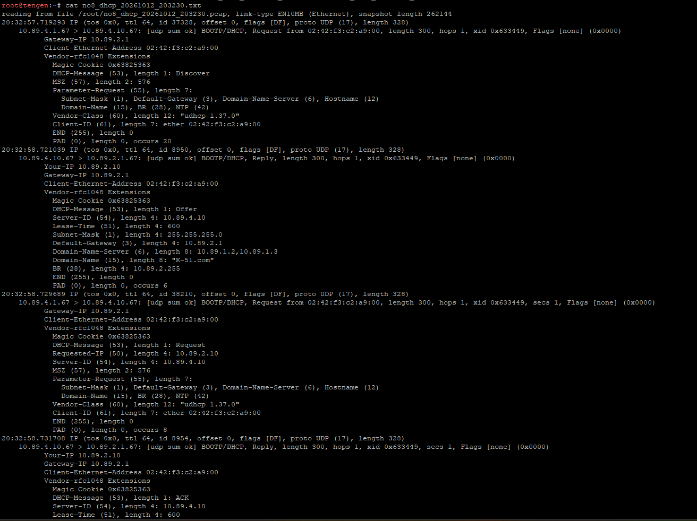

---

## Soal 9 — Simulasi gangguan DHCP Relay

### Tujuan

Membuktikan bahwa klien gagal mendapatkan lease baru ketika Relay dihentikan dan kembali berhasil setelah layanan Relay dipulihkan.

### Prosedur

1. Sebelum gangguan, minta lease baru pada Itadori dan simpan output bahwa lease berhasil.
2. Pada Jichi, hentikan relay:

   ```bash
   service isc-dhcp-relay stop
   pgrep -af dhcrelay
   ```

3. Pada klien uji, lepaskan/minta ulang lease sesuai utilitas yang tersedia. Contoh:

   ```bash
   pkill udhcpc 2>/dev/null || true
   ip addr flush dev eth0
   udhcpc -i eth0 -n -q -f
   ```

4. Catat kegagalan klien mendapatkan lease selama relay mati.
5. Pulihkan relay pada Jichi:

   ```bash
   service isc-dhcp-relay start
   pgrep -af dhcrelay
   ```

6. Ulangi permintaan lease dan pastikan klien kembali memperoleh IP dari pool yang benar serta gateway awalnya.

Pada pengujian yang dilakukan, Itadori berhasil memperoleh `10.89.2.10` sebelum gangguan, gagal memperoleh lease ketika relay dihentikan, lalu kembali berhasil setelah relay berjalan lagi.

### Bukti 9.1 — Klien Gagal Mendapat Lease
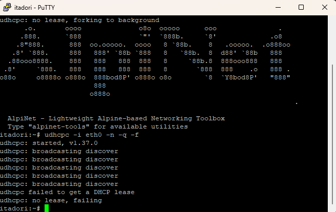

### Bukti 9.2 — DHCP Pulih
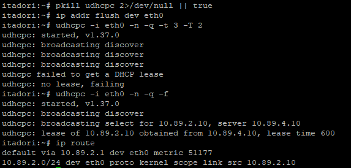

---

## Soal 10 — Persistensi setelah restart

### Tujuan

Memastikan konfigurasi Jichi dan layanan DHCP/Relay dapat berjalan kembali setelah node direstart.

### Pemeriksaan Jichi setelah restart

```bash
ip -br -4 addr
ip route
sysctl net.ipv4.ip_forward
iptables -t nat -S POSTROUTING
pgrep -af dhcrelay
```

Kondisi yang diharapkan: interface Jichi tetap memakai gateway `.1.1`–`.4.1`, default route WAN tetap tersedia, `ip_forward = 1`, aturan `MASQUERADE` tetap ada, dan proses DHCP Relay berjalan mengarah ke `10.89.4.10`.

### Pemeriksaan Tengen setelah restart

```bash
ip -br -4 addr
ip route
dhcpd -t -cf /etc/dhcp/dhcpd.conf
service isc-dhcp-server status
pgrep -af dhcpd
```

Lanjutkan dengan menguji klien Itadori, Miwa, dan Kugisaki. Ketiganya harus memperoleh konfigurasi sesuai pool, masa lease, serta reservasinya.

### Hasil yang telah terlihat

Jichi tetap memiliki IP interface, routing, `ip_forward=1`, dan aturan NAT setelah restart. Proses relay berjalan kembali, Itadori memperoleh `10.89.2.10` dari Tengen dengan lease 600 detik, Miwa mendapatkan alamat dari pool long lease, dan Kugisaki mendapatkan `10.89.3.99`.

### Bukti 10.1 — Kondisi Jichi Setelah Restart


### Bukti 10.2 — DHCP Relay Aktif


### Bukti 10.3 — Hasil Pengujian Klien


---

## Soal 11 — DNS Master dan Slave

### Tujuan

Membangun zona DNS `jujutsu.K-51.com` dengan Utahime sebagai Master dan Shoko sebagai Slave, meliputi SOA, NS, `allow-transfer`, serta sinkronisasi berdasarkan serial zona.

### Utahime (Master)

Berkas utama:

- `/etc/bind/named.conf.options`
- `/etc/bind/named.conf.local`
- `/etc/bind/db.jujutsu.K-51.com`

Deklarasi zona Master yang digunakan:

```conf
zone "jujutsu.K-51.com" {
    type master;
    file "/etc/bind/db.jujutsu.K-51.com";
    allow-transfer { 10.89.1.3; };
    also-notify { 10.89.1.3; };
    notify yes;
};
```

File zona memiliki SOA dengan serial yang dinaikkan setiap kali zona diubah, NS untuk Utahime dan Shoko, serta A record untuk kedua nameserver.

### Shoko (Slave)

Deklarasi zona utama:

```conf
zone "jujutsu.K-51.com" {
    type slave;
    masters { 10.89.1.2; };
    file "/var/cache/bind/db.jujutsu.K-51.com";
};
```

### Validasi dan pengujian

Di Utahime:

```bash
named-checkconf
named-checkzone jujutsu.K-51.com /etc/bind/db.jujutsu.K-51.com
service named status
dig @10.89.1.2 jujutsu.K-51.com SOA +short
dig @10.89.1.2 jujutsu.K-51.com NS +short
```

Di Shoko:

```bash
named-checkconf
service named status
ls -l /var/cache/bind/db.jujutsu.K-51.com
dig @10.89.1.3 jujutsu.K-51.com SOA +short
dig @10.89.1.3 jujutsu.K-51.com NS +short
```

Dari klien, lakukan query SOA ke kedua server. Naikkan serial pada file zona Utahime, validasi dengan `named-checkzone`, kemudian jalankan `service named reload`. Query SOA Shoko harus menunjukkan serial baru tanpa restart manual pada Shoko. Layanan menggunakan `named` pada lingkungan Debian yang digunakan.

### Bukti 11.1 — Validasi Zona Master


### Bukti 11.2 — Query SOA dan NS Master


### Bukti 11.3 — Zona pada Slave
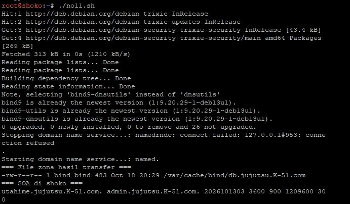

### Bukti 11.4 — Sinkronisasi Serial
.png)

### Bukti 11.5 — Query dari Klien


---

## Soal 12 — A, CNAME, PTR, dan DNS Forwarder

### Tujuan

Mengarahkan domain utama ke Gojo, membuat alias `www`, mengaktifkan Reverse DNS untuk IP Gojo, dan meneruskan query eksternal melalui `192.168.122.1`.

### Record zona utama

```dns
@       IN  A       10.89.1.4
www     IN  CNAME   jujutsu.K-51.com.
utahime IN  A       10.89.1.2
shoko   IN  A       10.89.1.3
gojo    IN  A       10.89.1.4
```

Serial zona utama dinaikkan setiap kali isi zona diubah. Gojo harus memakai IP `10.89.1.4`, tidak boleh berbenturan dengan IP Shoko `10.89.1.3`.

### Forwarder

Pada `/etc/bind/named.conf.options`, konfigurasi meliputi:

```conf
allow-query { 10.89.0.0/16; localhost; };
recursion yes;
allow-recursion { 10.89.0.0/16; localhost; };
forwarders { 192.168.122.1; };
forward only;
```

### Reverse DNS

Zona Reverse DNS untuk subnet `10.89.1.0/24` adalah `1.89.10.in-addr.arpa`. File `/etc/bind/db.10.89.1` berisi SOA, NS, dan PTR:

```dns
4 IN PTR jujutsu.K-51.com.
```

Zona reverse didaftarkan sebagai Master pada Utahime dan sebagai Slave pada Shoko supaya data PTR tersedia dari kedua DNS.

### Validasi dan pengujian

Di Utahime:

```bash
named-checkconf
named-checkzone jujutsu.K-51.com /etc/bind/db.jujutsu.K-51.com
named-checkzone 1.89.10.in-addr.arpa /etc/bind/db.10.89.1
service named reload
```

Dari klien:

```bash
dig @10.89.1.2 jujutsu.K-51.com A +short
dig @10.89.1.2 www.jujutsu.K-51.com CNAME +short
dig @10.89.1.2 -x 10.89.1.4 +short
dig @10.89.1.3 www.jujutsu.K-51.com CNAME +short
dig @10.89.1.3 -x 10.89.1.4 +short
dig @10.89.1.2 google.com A +short
dig @10.89.1.3 google.com A +short
ping -c 3 google.com
```

Hasil yang sudah terlihat pada pengerjaan: A record mengembalikan `10.89.1.4`; CNAME dan PTR mengembalikan `jujutsu.K-51.com.`; kedua DNS menjawab query `google.com`; dan klien menerima balasan ICMP dari `google.com` pada pengujian.

### Bukti 12.1 — A Record Domain Utama


### Bukti 12.2 — CNAME www


### Bukti 12.3 — Reverse DNS PTR


### Bukti 12.4 — DNS Forwarder
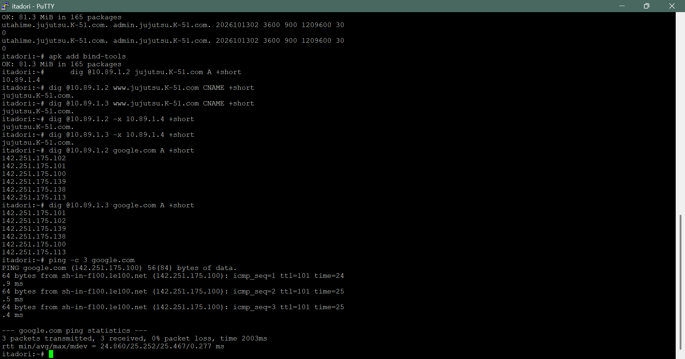

### Bukti 12.5 — Ping Domain Eksternal


---

## Soal 13 — MariaDB Master-Slave
 
### Tujuan
 
Menyiapkan Yaga sebagai MariaDB Master dan Inumaki sebagai Slave, membuat database `db_shibuya_K-51` dengan tabel `request_logs`, mengaktifkan binary logging, dan melakukan replikasi dari Master ke Slave.
 
| Node | Peran | IP | `server-id` |
|---|---|---|---|
| `yaga` | Master | `10.89.4.22` | `1` |
| `inumaki` | Slave | `10.89.4.23` | `2` |
 
### Yaga (Master)
 
Script `/root/no13.sh` pada Yaga memasang MariaDB dan mengatur file `/etc/mysql/mariadb.conf.d/60-replication.cnf`:
 
```ini
[mysqld]
bind-address = 0.0.0.0
server-id = 1
log-bin = mysql-bin
binlog_format = ROW
```
 
Database dan tabel yang dibuat:
 
```sql
CREATE DATABASE IF NOT EXISTS `db_shibuya_K-51`;
USE `db_shibuya_K-51`;
CREATE TABLE IF NOT EXISTS request_logs (
    id INT AUTO_INCREMENT PRIMARY KEY,
    worker VARCHAR(50),
    endpoint VARCHAR(255),
    client_ip VARCHAR(45),
    created_at TIMESTAMP DEFAULT CURRENT_TIMESTAMP
);
```
 
Nama database mengandung tanda `-`, sehingga harus diapit backtick di SQL. Di dalam heredoc bash tanpa kutip (`<<EOF`), backtick ditulis sebagai `` \` `` agar tidak dieksekusi sebagai command substitution oleh bash.
 
Pengguna yang dibuat:
 
| User | Host | Hak akses | Kegunaan |
|---|---|---|---|
| `repl` | `10.89.4.%` | `REPLICATION SLAVE, REPLICATION CLIENT` | Koneksi replikasi dari Inumaki |
| `shibuya` | `10.89.4.%` | `ALL PRIVILEGES` pada `db_shibuya_K-51` | Akses remote seluruh node Network 4 |
 
### Inumaki (Slave)
 
Script `/root/no13.sh` pada Inumaki mengatur:
 
```ini
[mysqld]
bind-address = 0.0.0.0
server-id = 2
relay-log = relay-bin
read_only = 1
```
 
Script mengambil nama binary log **pertama** dari Yaga secara otomatis, lalu menghubungkan Slave menggunakan `CHANGE MASTER TO`:
 
```bash
FIRST_LOG=$(mysql -h 10.89.4.22 -u repl -preplpass -N -e "SHOW BINARY LOGS;" | head -1 | awk '{print $1}')
```
 
```sql
CHANGE MASTER TO
    MASTER_HOST='10.89.4.22',
    MASTER_USER='repl',
    MASTER_PASSWORD='replpass',
    MASTER_PORT=3306,
    MASTER_LOG_FILE='<FIRST_LOG>',
    MASTER_LOG_POS=4;
START SLAVE;
```
 
Replikasi dimulai dari binlog pertama (`MASTER_LOG_POS=4`) karena database, tabel, dan user sudah dibuat di Yaga sebelum Inumaki terhubung. Dengan cara ini seluruh perubahan sejak awal ikut tersalin ke Slave.
 
**Catatan:** script Inumaki hanya dijalankan pada Slave yang masih kosong. Jika dijalankan ulang ketika Slave sudah berisi data, replikasi akan memutar ulang `INSERT` lama dan berhenti dengan error `Duplicate entry '1' for key 'PRIMARY'` (`Slave_SQL_Running: No`). Untuk mengulang dari awal:
 
```bash
mysql -u root -e 'STOP SLAVE; DROP DATABASE IF EXISTS `db_shibuya_K-51`;'
bash /root/no13.sh
```
 
### Verifikasi
 
Di Yaga:
 
```bash
mysql -u root -e "SHOW MASTER STATUS;"
mysql -u root -e "SHOW BINARY LOGS;"
```
 
Di Inumaki:
 
```bash
mysql -u root -e "SHOW SLAVE STATUS\G" | grep -E "Master_Host|Slave_IO_Running|Slave_SQL_Running|Last_SQL_Error"
mysql -u root -e "SHOW DATABASES;"
```
 
Kriteria: `Slave_IO_Running: Yes`, `Slave_SQL_Running: Yes`, `Last_SQL_Error` kosong, dan `db_shibuya_K-51` tersedia.
 
Uji replikasi dengan menambahkan data di Yaga:
 
```bash
mysql -u root -e "INSERT INTO \`db_shibuya_K-51\`.request_logs (worker, endpoint, client_ip) VALUES ('test', '/tes', '10.89.2.10');"
```
 
Lalu periksa di Inumaki:
 
```bash
mysql -u root -e 'SELECT * FROM `db_shibuya_K-51`.request_logs ORDER BY id DESC LIMIT 5;'
```
 
Uji akses remote dari node Network 4 lain (contoh: Nanami):
 
```bash
mysql -h 10.89.4.22 -u shibuya -pshibuyapass -e "SHOW DATABASES;"
```
 
### Bukti 13.1 — Konfigurasi Master

 
### Bukti 13.2 — Status Slave

 
### Bukti 13.3 — Data Tereplikasi

 
---

## Soal 14 — Frontend dan API worker
 
### Tujuan
 
Menyiapkan Maki dan Panda sebagai frontend menggunakan Nginx/PHP-FPM, serta Nanami, Todo, dan Kirara sebagai API worker yang mencatat request ke database Yaga. Akses langsung ke worker dibatasi.
 
| Worker | Node | IP | Hanya menerima dari |
|---|---|---|---|
| Frontend | Maki | `10.89.4.12` | Gojo `10.89.1.4` (jalur proxy web, Soal 16) |
| Frontend | Panda | `10.89.4.13` | Gojo `10.89.1.4` |
| API | Nanami | `10.89.4.14` | Geto `10.89.4.11` |
| API | Todo | `10.89.4.15` | Geto `10.89.4.11` |
| API (cadangan) | Kirara | `10.89.4.16` | Geto `10.89.4.11` |
 
Soal 14 menyebut frontend hanya menerima trafik dari "jalur proxy web yang ditentukan". Jalur tersebut adalah Gojo, karena Soal 16 menetapkan Gojo sebagai reverse proxy yang meneruskan `/` ke Maki dan Panda.
 
### Frontend Maki dan Panda
 
Script `/root/no14.sh` memasang Nginx dan PHP-FPM, menampilkan hostname worker pada halaman frontend, dan membuat virtual host untuk `jujutsu.K-51.com` serta `www.jujutsu.K-51.com`. Pembatasan akses:
 
```nginx
allow 10.89.1.4;
allow 127.0.0.1;
deny all;
```
 
### API Nanami, Todo, dan Kirara
 
Script `/root/no14.sh` memasang Nginx, PHP-FPM, `php-mysql`, dan `mariadb-client`; membuat endpoint API yang mengembalikan JSON dan mencatat request ke tabel `request_logs` pada Yaga. Kirara memakai script dan endpoint yang identik agar kompatibel sebagai cadangan pada Soal 18. Pembatasan akses:
 
```nginx
allow 10.89.4.11;
allow 127.0.0.1;
deny all;
```
 
Data request yang disimpan: nama worker, endpoint, `client_ip`, dan timestamp.
 
### Verifikasi
 
| Asal | Tujuan | Hasil yang diharapkan |
|---|---|---|
| Klien | Maki / Nanami langsung | `403 Forbidden` |
| Gojo | Maki / Panda | `200`, halaman berisi hostname |
| Geto | Nanami / Todo / Kirara | `200`, JSON |
| Gojo | Nanami (silang) | `403 Forbidden` |
| Geto | Maki (silang) | `403 Forbidden` |
 
Dari klien, akses langsung ke worker:
 
```bash
curl -i http://10.89.4.12/
curl -i http://10.89.4.14/api
```
 
Dari Gojo, uji akses ke frontend:
 
```bash
curl -H 'Host: jujutsu.K-51.com' http://10.89.4.12/
curl -H 'Host: jujutsu.K-51.com' http://10.89.4.13/
```
 
Dari Geto, uji API:
 
```bash
curl http://10.89.4.14/api
curl http://10.89.4.15/api
curl http://10.89.4.16/api
```
 
Uji silang untuk membuktikan pembatasan spesifik per jalur:
 
```bash
curl -i http://10.89.4.14/api   # dari Gojo → 403
curl -i http://10.89.4.12/      # dari Geto → 403
```
 
Pada Yaga, periksa log:
 
```bash
mysql -u root -e 'SELECT * FROM `db_shibuya_K-51`.request_logs ORDER BY id DESC LIMIT 5;'
```
 
### Bukti 14.1 — Frontend Worker
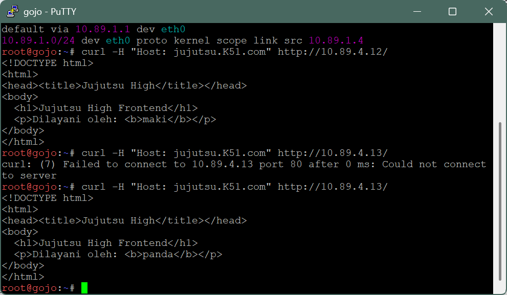
 
### Bukti 14.2 — Respons API
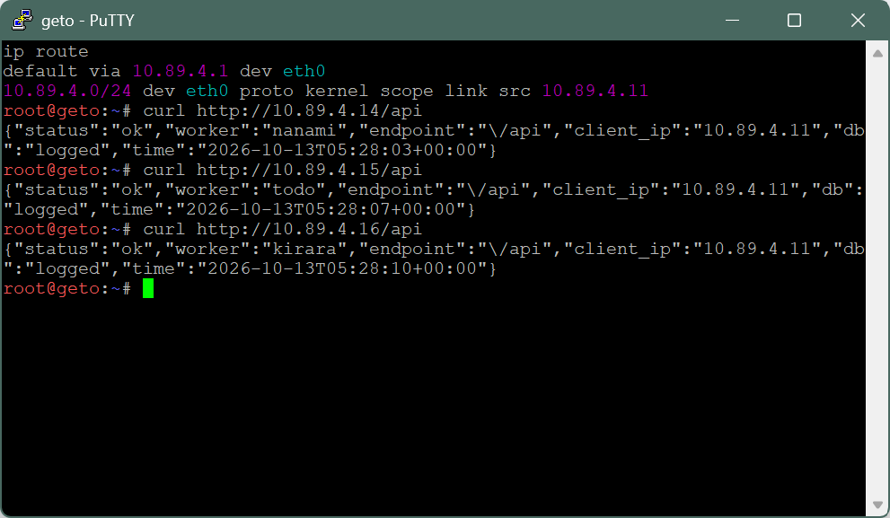
 
### Bukti 14.3 — Pembatasan Akses
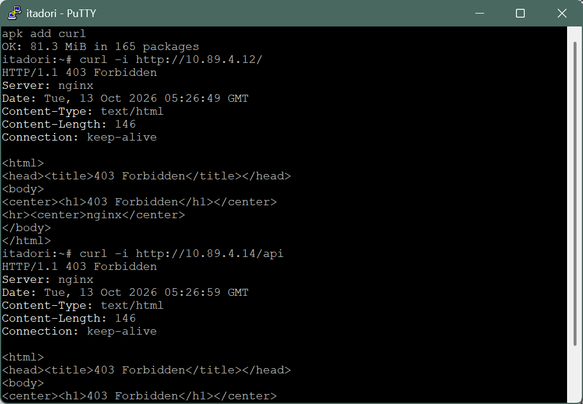
 
### Bukti 14.4 — Request Log Database
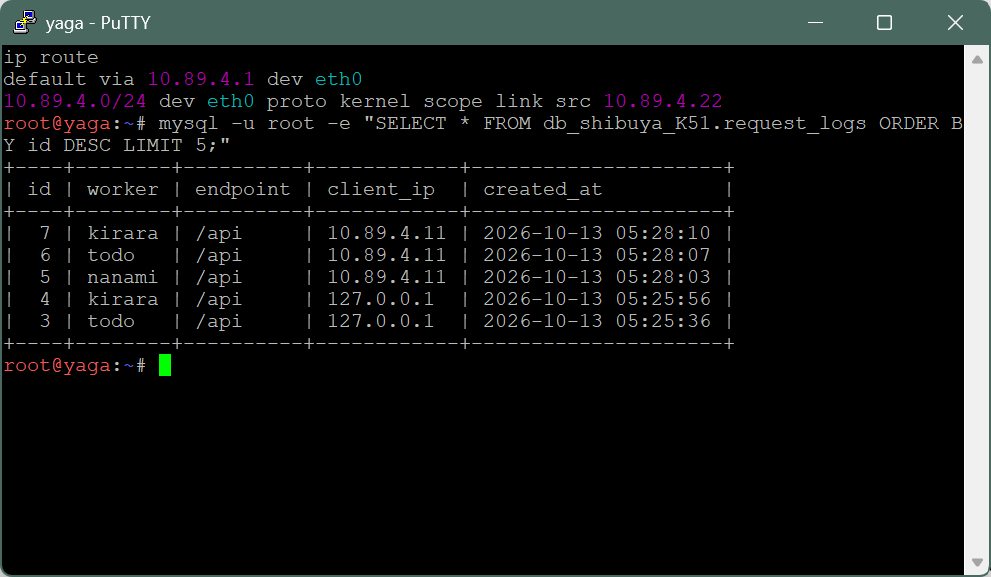
 
---
 
## Soal 15 — Internal Load Balancer Geto
 
### Tujuan
 
Mengatur Nginx pada Geto untuk membagi trafik API antara Nanami dan Todo menggunakan Weighted Round Robin dengan bobot 3:1.
 
### Konfigurasi upstream
 
Script `/root/no15.sh` pada Geto memakai:
 
```nginx
upstream api_cluster {
    zone api_cluster 64k;
    server 10.89.4.14 weight=3;
    server 10.89.4.15 weight=1;
}
```
 
Direktif `zone` membuat status upstream disimpan di shared memory. Nginx menjalankan beberapa worker process; tanpa `zone`, setiap worker process menghitung giliran Weighted Round Robin secara terpisah sehingga rasio total dapat menyimpang dari 3:1.
 
Server Nginx meneruskan request ke `api_cluster` dan mengirim header `Host`, `X-Real-IP`, serta `X-Forwarded-For`.
 
### Verifikasi
 
Uji dari Geto:
 
```bash
curl http://127.0.0.1/api
```
 
Uji beberapa request dari node Network 4 (sesuai soal: dari jaringan lokal Data Center):
 
```bash
for i in $(seq 1 20); do
  curl -s http://10.89.4.11/api | grep -o '"worker":"[a-z]*"'
done | sort | uniq -c
```
 
Hasil yang diharapkan untuk 20 request: 15 `nanami` dan 5 `todo`.
 
Periksa distribusi catatan di Yaga:
 
```bash
mysql -u root -e 'SELECT worker, COUNT(*) FROM `db_shibuya_K-51`.request_logs GROUP BY worker;'
```
 
### Bukti 15.1 — Konfigurasi Upstream

 
### Bukti 15.2 — Distribusi Request
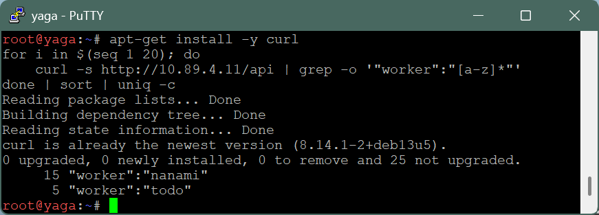
 
---
 
## Soal 16 — Public reverse proxy Gojo
 
### Tujuan
 
Menjadikan Gojo sebagai pintu masuk publik. Request path `/` diteruskan secara Round Robin ke Maki dan Panda, sedangkan request `/api` diteruskan ke Geto.
 
```text
klien → jujutsu.K-51.com (Gojo 10.89.1.4)
          ├─ /     → Maki ⇄ Panda (round robin)
          └─ /api  → Geto → Nanami (3) / Todo (1)
```
 
### Konfigurasi utama
 
Script `/root/no16.sh` pada Gojo memasang Nginx dan membuat upstream frontend:
 
```nginx
upstream frontend_cluster {
    zone frontend_cluster 64k;
    server 10.89.4.12;
    server 10.89.4.13;
}
```
 
Pada virtual host `jujutsu.K-51.com` dan `www.jujutsu.K-51.com`:
 
- `location /` menggunakan `frontend_cluster`.
- `location /api` meneruskan request ke `http://10.89.4.11` (tanpa `/` di akhir agar path `/api` diteruskan utuh).
- Header `Host`, `X-Real-IP`, dan `X-Forwarded-For` diteruskan ke upstream.
### Verifikasi
 
Pastikan klien menggunakan DNS internal (diperoleh dari DHCP, lihat Soal 5):
 
```bash
cat /etc/resolv.conf
nslookup jujutsu.K-51.com
```
 
Hasil `nslookup` harus `10.89.1.4`. Jika resolver masih `192.168.122.1`, klien akan bertanya ke DNS internet dan tidak menemukan domain praktikum.
 
Uji Round Robin frontend:
 
```bash
for i in $(seq 1 6); do
  curl -s http://jujutsu.K-51.com/ | grep -o '<b>[a-z]*</b>'
done
```
 
Uji domain www:
 
```bash
curl -s http://www.jujutsu.K-51.com/ | grep -o '<b>[a-z]*</b>'
```
 
Uji load balancer API:
 
```bash
for i in $(seq 1 8); do
  curl -s http://jujutsu.K-51.com/api | grep -o '"worker":"[a-z]*"'
done | sort | uniq -c
```
 
Uji akses langsung ke worker frontend/API dari klien dan pastikan ditolak (`403`).
 
**Catatan:** setelah cache Soal 19 aktif, request `/` selama 10 menit dilayani dari cache Gojo sehingga hostname yang tampil tidak berganti. Untuk mendemonstrasikan round robin Soal 16, kosongkan cache terlebih dahulu:
 
```bash
rm -rf /var/cache/nginx/frontend/*
service nginx reload
```
 
### Bukti 16.1 — Konfigurasi Reverse Proxy

 
### Bukti 16.2 — Respons Frontend
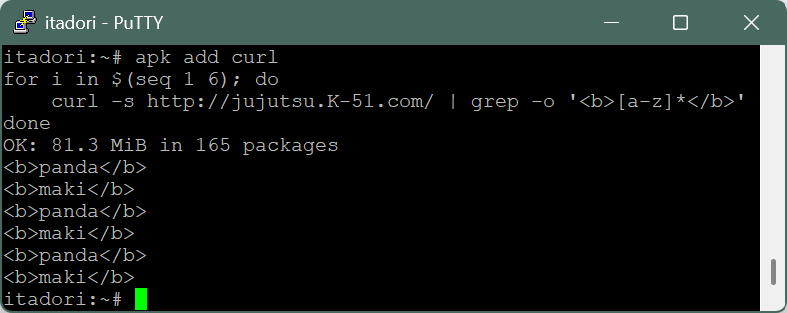
 
### Bukti 16.3 — Respons API
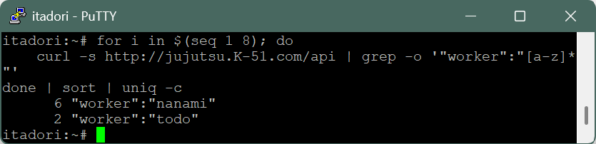
 
---
 
## Soal 17 — Penerusan IP klien
 
### Tujuan
 
Mencatat IP asli klien pada `request_logs`, bukan IP proxy. Geto hanya mempercayai informasi alamat klien ketika request datang dari Gojo, dan API worker hanya mempercayainya ketika request datang dari Geto.
 
| Node | Peran pada rantai IP klien |
|---|---|
| Gojo | Mengisi `X-Real-IP` dengan IP klien dan menambahkannya ke `X-Forwarded-For` (sudah dari Soal 16) |
| Geto | Mempercayai `X-Real-IP` hanya dari Gojo (`set_real_ip_from`), lalu meneruskannya ke worker |
| Nanami, Todo, Kirara | Mempercayai `X-Real-IP` hanya dari Geto (`$trusted_proxy`), lalu menyimpan ke `client_ip` (sudah dari Soal 14) |
 
### Konfigurasi Geto
 
Script `/root/no17.sh` pada Geto:
 
```nginx
map $http_x_forwarded_for $xff_chain {
    ""      $realip_remote_addr;
    default "$http_x_forwarded_for, $realip_remote_addr";
}
 
upstream api_cluster {
    zone api_cluster 64k;
    server 10.89.4.14 weight=3;
    server 10.89.4.15 weight=1;
}
 
server {
    listen 80 default_server;
    server_name jujutsu.K-51.com www.jujutsu.K-51.com;
 
    set_real_ip_from 10.89.1.4;
    real_ip_header X-Real-IP;
 
    location / {
        proxy_pass http://api_cluster;
        proxy_set_header Host $host;
        proxy_set_header X-Real-IP $remote_addr;
        proxy_set_header X-Forwarded-For $xff_chain;
    }
}
```
 
- `set_real_ip_from` + `real_ip_header`: jika request berasal dari `10.89.1.4`, `$remote_addr` diganti dengan isi `X-Real-IP`. Dari sumber lain, header tersebut diabaikan.
- `map $xff_chain`: menyusun `X-Forwarded-For` menjadi `<IP klien>, 10.89.1.4`. Memakai `$proxy_add_x_forwarded_for` setelah modul realip aktif akan menghasilkan `<IP klien>, <IP klien>` karena `$remote_addr` sudah diganti; `$realip_remote_addr` menyimpan alamat koneksi asli (Gojo).
Periksa konfigurasi Gojo dan API worker:
 
```bash
grep -n 'X-Real-IP\|X-Forwarded-For' /etc/nginx/sites-available/gojo-proxy
grep -n 'trusted_proxy' /var/www/api/index.php
```
 
### Verifikasi
 
Dari klien Network 2 dan Network 3:
 
```bash
curl -s http://jujutsu.K-51.com/api
```
 
Field `client_ip` pada JSON harus sama dengan IP klien (`10.89.2.x` atau `10.89.3.x`).
 
Periksa database pada Yaga:
 
```bash
mysql -u root -e 'SELECT id, worker, endpoint, client_ip, created_at FROM `db_shibuya_K-51`.request_logs ORDER BY id DESC LIMIT 10;'
```
 
Uji header palsu dari node Network 4 langsung ke Geto:
 
```bash
curl -s -H 'X-Real-IP: 1.2.3.4' http://10.89.4.11/api
```
 
`client_ip` harus berisi IP node pengirim, bukan `1.2.3.4`. Uji yang sama dari klien melalui Gojo tetap menghasilkan IP klien asli, karena Gojo menimpa `X-Real-IP` dengan `$remote_addr`:
 
```bash
curl -s -H 'X-Real-IP: 1.2.3.4' http://jujutsu.K-51.com/api
```
 
### Bukti 17.1 — Header pada Proxy
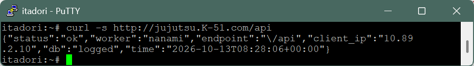
 
### Bukti 17.2 — Data client_ip
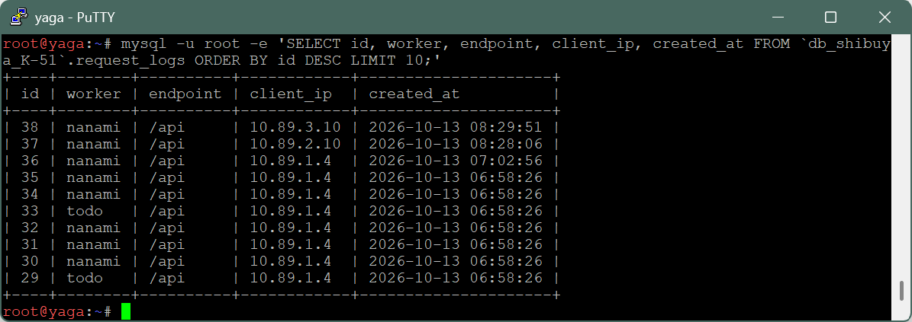
 
---
 
## Soal 18 — API fallback ke Kirara
 
### Tujuan
 
Menjadikan Kirara sebagai server API cadangan ketika Nanami dan Todo gagal melayani request. Konfigurasi upstream di Geto menggunakan passive health check dengan `max_fails=2` dan `fail_timeout=5s`.
 
### Konfigurasi
 
Script `/root/no18.sh` pada Geto (menggabungkan konfigurasi Soal 15 dan 17):
 
```nginx
upstream api_cluster {
    zone api_cluster 64k;
    server 10.89.4.14 weight=3 max_fails=2 fail_timeout=5s;
    server 10.89.4.15 weight=1 max_fails=2 fail_timeout=5s;
    server 10.89.4.16 backup;
}
```
 
Pada `location /`:
 
```nginx
proxy_next_upstream error timeout http_502 http_503 http_504;
proxy_next_upstream_tries 3;
proxy_connect_timeout 2s;
```
 
- `max_fails=2 fail_timeout=5s`: jika terjadi 2 kegagalan dalam 5 detik, worker dianggap tidak tersedia selama 5 detik.
- `backup`: Kirara hanya dipakai ketika **seluruh** worker utama tidak tersedia. Jika hanya satu worker utama mati, trafik dialihkan ke worker utama lainnya.
- `proxy_next_upstream ... http_502`: ketika PHP-FPM worker berhenti, Nginx worker masih hidup dan membalas `502`. Tanpa `http_502` di daftar ini, Geto meneruskan `502` tersebut ke klien. Dengan baris ini, Geto mencoba upstream berikutnya.
- `proxy_connect_timeout 2s`: mempercepat perpindahan ke upstream lain (default 60 detik).
### Verifikasi
 
Kondisi normal (Kirara tidak muncul):
 
```bash
for i in $(seq 1 8); do
  curl -s http://jujutsu.K-51.com/api | grep -o '"worker":"[a-z]*"'
done | sort | uniq -c
```
 
Pastikan Kirara siap (dari Geto):
 
```bash
curl -s http://10.89.4.16/api
```
 
Simulasi 1 — Nginx mati pada Nanami dan Todo:
 
```bash
service nginx stop
```
 
Simulasi 2 — layanan API (PHP-FPM) mati pada Nanami dan Todo:
 
```bash
service nginx start
service php8.4-fpm stop
```
 
Pada setiap simulasi, uji dari klien:
 
```bash
for i in $(seq 1 6); do
  curl -s -o /dev/null -w '%{http_code} ' http://jujutsu.K-51.com/api
  curl -s http://jujutsu.K-51.com/api | grep -o '"worker":"[a-z]*"'
done
```
 
Hasil yang diharapkan: seluruh status `200`, dijawab `"worker":"kirara"`, tanpa `502 Bad Gateway`.
 
Pemulihan pada Nanami dan Todo:
 
```bash
service nginx start
service php8.4-fpm start
```
 
Setelah sekitar 5 detik (`fail_timeout`), ulangi uji kondisi normal; Nanami dan Todo kembali melayani request. Bukti tambahan di Yaga:
 
```bash
mysql -u root -e 'SELECT worker, COUNT(*) FROM `db_shibuya_K-51`.request_logs GROUP BY worker;'
```
 
### Bukti 18.1 — Konfigurasi Backup Upstream

 
### Bukti 18.2 — Kondisi Worker Utama Berhenti

 
### Bukti 18.3 — Respons dari Kirara
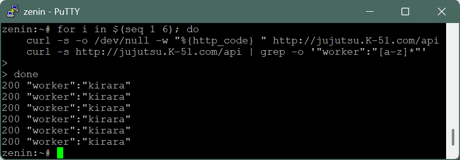
 
---
 
## Soal 19 — Proxy cache dan rate limiting
 
### Tujuan
 
Mengaktifkan cache untuk frontend selama 10 menit, menambahkan header `X-Cache-Status`, dan membatasi request `/api` menjadi 10 request per detik per IP klien.
 
### Konfigurasi utama di Gojo
 
Script `/root/no19.sh` (menggabungkan konfigurasi Soal 16 dan 17) mengatur zona cache, rate limit, dan format log pada konteks HTTP Nginx:
 
```nginx
proxy_cache_path /var/cache/nginx/frontend levels=1:2 keys_zone=frontend_cache:10m max_size=100m inactive=10m use_temp_path=off;
limit_req_zone $binary_remote_addr zone=api_limit:10m rate=10r/s;
 
log_format gojo_detail '$remote_addr [$time_local] "$request" status=$status '
                       'upstream=$upstream_addr up_status=$upstream_status '
                       'cache=$upstream_cache_status rt=$request_time';
```
 
Pada blok `server`:
 
```nginx
access_log /var/log/nginx/gojo_access.log gojo_detail;
error_log  /var/log/nginx/gojo_error.log;
```
 
Lokasi frontend (`/`):
 
```nginx
proxy_cache frontend_cache;
proxy_cache_valid 200 302 10m;
proxy_cache_valid 404 1m;
add_header X-Cache-Status $upstream_cache_status always;
```
 
Lokasi `/api`:
 
```nginx
limit_req zone=api_limit;
limit_req_status 429;
limit_req_log_level warn;
```
 
| Direktif | Penjelasan |
|---|---|
| `$binary_remote_addr` | Kunci rate limit adalah IP klien; setiap IP dihitung terpisah |
| `rate=10r/s` | 1 request per 100 ms per IP; tanpa `burst`, request yang lebih cepat langsung ditolak |
| `limit_req_status 429` | Mengganti default `503` menjadi `429 Too Many Requests` agar dapat dibedakan dari kegagalan aplikasi pada Soal 20 |
| `log_format gojo_detail` | Mencatat status, upstream, status upstream, status cache, dan waktu request untuk analisis Soal 20 |
 
Endpoint `/api` tidak ikut dicache karena `proxy_cache` hanya dipasang pada `location /`.
 
### Verifikasi cache
 
Kosongkan cache sebelum pengujian:
 
```bash
rm -rf /var/cache/nginx/frontend/*
service nginx reload
```
 
Dari klien:
 
```bash
for i in 1 2 3; do
  curl -s -D - -o /dev/null http://jujutsu.K-51.com/ | grep -i x-cache-status
done
```
 
Hasil yang diharapkan: `MISS`, kemudian `HIT`, `HIT`.
 
Uji bahwa API tidak menggunakan cache (tidak ada output):
 
```bash
curl -s -D - -o /dev/null http://jujutsu.K-51.com/api | grep -i x-cache-status
```
 
### Verifikasi rate limiting
 
Request berjarak 200 ms (5 r/s, di bawah batas) seluruhnya `200`:
 
```bash
for i in $(seq 1 5); do
  curl -s -o /dev/null -w '%{http_code}\n' http://jujutsu.K-51.com/api
  sleep 0.2
done
```
 
Burst 30 request paralel:
 
```bash
(for i in $(seq 1 30); do
  curl -s -o /dev/null -w '%{http_code}\n' http://jujutsu.K-51.com/api &
done; wait) | sort | uniq -c
```
 
Sebagian besar respons berstatus `429`.
 
Periksa log Gojo:
 
```bash
tail -n 20 /var/log/nginx/gojo_access.log
grep 'limiting requests' /var/log/nginx/gojo_error.log | tail -n 5
```
 
Request yang ditolak tercatat sebagai `status=429 upstream=-`, artinya tidak diteruskan ke Geto.
 
### Bukti 19.1 — Cache MISS

 
### Bukti 19.2 — Cache HIT
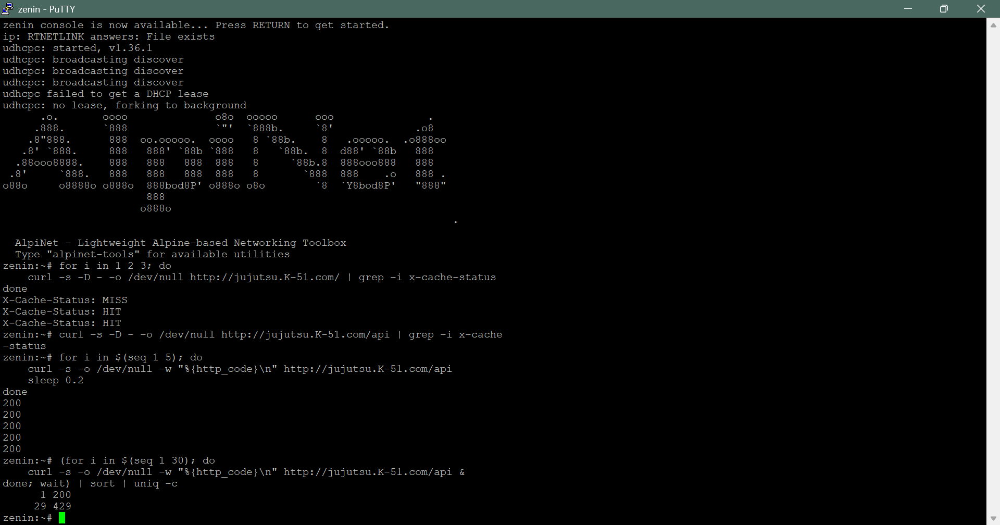
 
### Bukti 19.3 — Rate Limiting

 
### Bukti 19.4 — Log Rate Limit
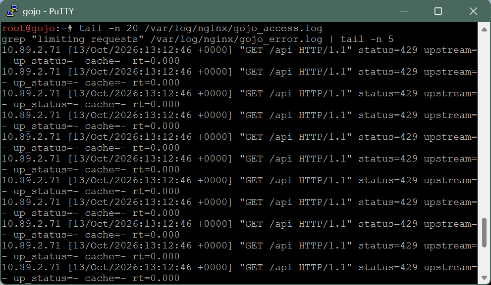
 
---
 
## Soal 20 — Benchmark dengan ApacheBench
 
### Tujuan
 
Mengukur performa layanan dengan ApacheBench dari Kusakabe, mencatat Requests per Second (RPS), latensi, request gagal, dan efek rate limit pada endpoint API.
 
### Parameter pengujian
 
| Tes | URL | Rate limit |
|---|---|---|
| 1. Baseline frontend | `http://jujutsu.K-51.com/` | Tidak berlaku pada `/` |
| 2. API dengan rate limit | `http://jujutsu.K-51.com/api` | Aktif (10 r/s) |
| 3. API tanpa rate limit (pembanding) | `http://jujutsu.K-51.com/api` | Dimatikan sementara |
 
Seluruh tes memakai `-n 600` (total request) dan `-c 30` (concurrency).
 
### Script
 
| Node | Script | Fungsi |
|---|---|---|
| Kusakabe | `/root/no20.sh` | `sh no20.sh web\|api\|api-nolimit`; menjalankan `ab` dan menyimpan hasil di `/root/no20-hasil/` |
| Gojo | `/root/no20-log.sh` | `bash no20-log.sh reset\|limit-off\|limit-on\|analyze`; mengosongkan log, mengatur rate limit, dan menganalisis log |
 
Pada Alpine, `ab` dipasang dengan `apk add apache2-utils`.
 
### Prosedur
 
Tes 1 — baseline frontend:
 
1. Gojo: `bash /root/no20-log.sh reset`
2. Kusakabe: `sh /root/no20.sh web`
3. Gojo: `bash /root/no20-log.sh analyze`
Tes 2 — API dengan rate limit:
 
1. Gojo: `bash /root/no20-log.sh reset`
2. Kusakabe: `sh /root/no20.sh api`
3. Gojo: `bash /root/no20-log.sh analyze`
Tes 3 — API tanpa rate limit:
 
1. Gojo: `bash /root/no20-log.sh limit-off`
2. Gojo: `bash /root/no20-log.sh reset`
3. Kusakabe: `sh /root/no20.sh api-nolimit`
4. Gojo: `bash /root/no20-log.sh analyze`
5. **Wajib pulihkan rate limit:** `bash /root/no20-log.sh limit-on`
### Membaca output ApacheBench
 
| Field | Arti |
|---|---|
| `Requests per second` | Jumlah request yang diselesaikan per detik (RPS) |
| `Time per request` (mean) | Rata-rata latensi per request dari sisi satu klien (ms) |
| `Percentage of the requests served within` | Distribusi latensi (50%, 95%, 99%) |
| `Failed requests` | Kegagalan koneksi, atau respons dengan panjang berbeda dari respons pertama (`Length`) |
| `Non-2xx responses` | Respons berstatus selain `2xx`, termasuk `429` |
 
**Catatan penting:**
 
- Respons `429` **tidak** dihitung sebagai `Failed requests`; respons tersebut masuk ke `Non-2xx responses`.
- Pada `/api`, `ab` dapat melaporkan `Failed requests (Length: ...)` walaupun seluruh request berstatus `200`, karena isi JSON (nama worker dan waktu) berbeda di setiap respons sehingga panjangnya berubah. Angka ini bukan kegagalan layanan. Status sebenarnya dipastikan melalui access log Gojo.
- RPS yang tinggi pada Tes 2 tidak berarti backend API cepat, karena sebagian besar request dijawab `429` langsung oleh Gojo tanpa diteruskan ke Geto.
### Klasifikasi kegagalan pada access log Gojo
 
| Jenis | Ciri pada log |
|---|---|
| Ditolak rate limit | `status=429 upstream=-` |
| Kegagalan aplikasi | `status=5xx` dengan `up_status=5xx` (upstream menjawab, tetapi error) |
| Kegagalan koneksi | `status=502`/`504` dengan `up_status=-` atau `502`, serta `connect() failed` / `upstream timed out` pada `gojo_error.log` |
| Klien memutus koneksi | `status=499` |
| Sukses | `status=200` |
 
### Hasil benchmark
 
| Metrik | Frontend `/` | `/api` + rate limit | `/api` tanpa limit |
|---|---|---|---|
| Complete requests | | | |
| Requests per second | | | |
| Time per request (mean, ms) | | | |
| Latensi 50% (ms) | | | |
| Latensi 95% (ms) | | | |
| Latensi 99% (ms) | | | |
| Failed requests (ab) | | | |
| Non-2xx responses (ab) | | | |
| Status 200 (log Gojo) | | | |
| Status 429 (log Gojo) | | | |
| Kegagalan aplikasi 5xx (log Gojo) | | | |
| Kegagalan koneksi (error log Gojo) | | | |
| Cache HIT / MISS (log Gojo) | | – | – |
 
### Analisis
 
Tuliskan berdasarkan angka yang benar-benar diperoleh. Poin yang perlu dibahas:
 
1. Perbandingan RPS dan latensi frontend `/` (dilayani dari cache Gojo) dengan `/api` tanpa limit (melewati Gojo, Geto, worker, dan query ke Yaga).
2. Proporsi `429` pada Tes 2 dan dampaknya terhadap beban backend.
3. Perbedaan `Failed requests` (ab) dengan kegagalan sebenarnya pada access log.
4. Ada atau tidaknya kegagalan aplikasi maupun koneksi selama pengujian.
### Bukti 20.1 — Benchmark Frontend
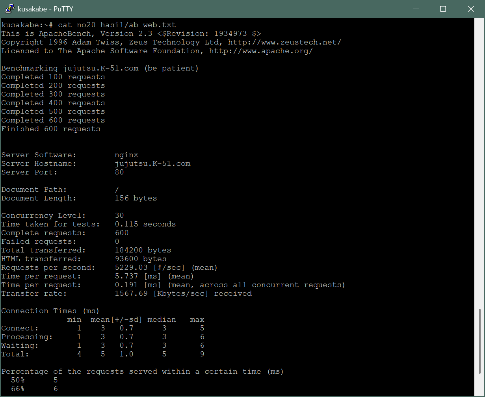
 
### Bukti 20.2 — Benchmark API
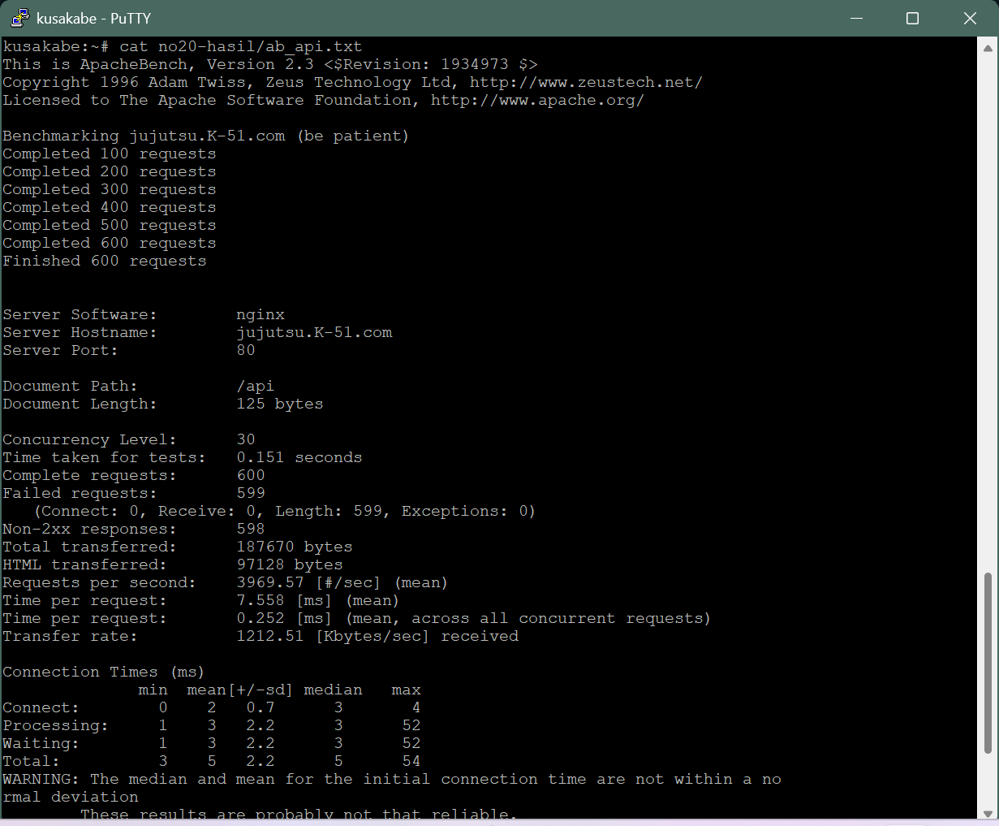
 
### Bukti 20.3 — Analisis Log
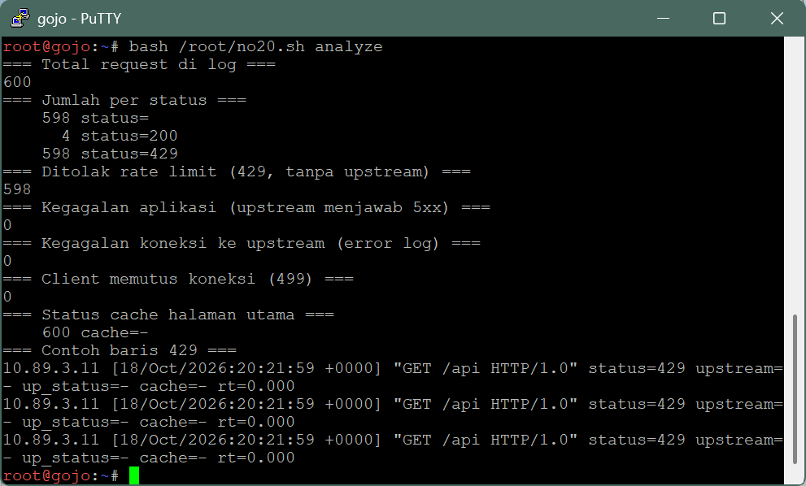

---

## Kesimpulan

Praktikum Modul 3 mencakup pemulihan jaringan, DHCP server dan relay, pengaturan pool dan lease, validasi serta analisis paket DHCP, DNS Master-Slave, database replication, frontend dan API worker, load balancing, reverse proxy, penerusan IP klien, failover, cache/rate limiting, serta benchmarking. Setiap nomor harus dibuktikan melalui validasi konfigurasi dan pengujian aktual. Hasil akhir, screenshot, dan angka pengujian perlu disesuaikan dengan kondisi nyata proyek GNS3 yang digunakan.
